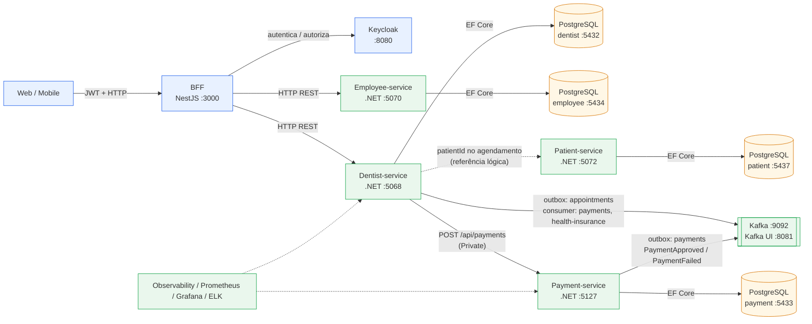
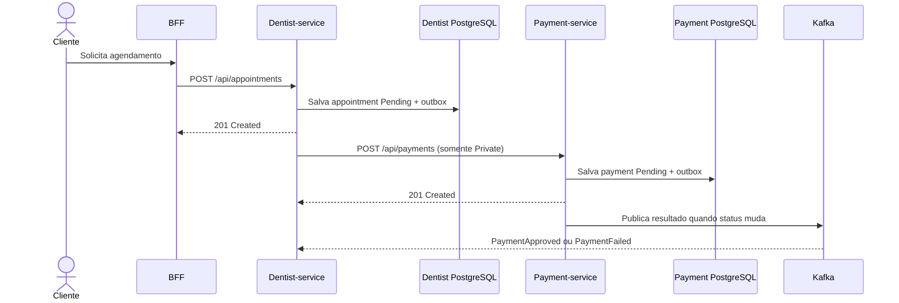

# Odontologia Integrada — Projeto Multiplataforma

Monorepo da plataforma de gestão odontológica. Reúne o **BFF** (NestJS), quatro APIs
**.NET 10**, uma biblioteca de **mensageria Kafka** compartilhada e a infraestrutura
em Docker. O [`compose.yaml`](compose.yaml) na raiz reúne aplicações, bancos,
mensageria, autenticação, métricas e logs.

Este documento é o guia **de ponta a ponta**: como subir o sistema e executar os
serviços individualmente durante o desenvolvimento.

---

## Arquitetura



**Legenda:** linha contínua representa uma chamada ou dependência operacional;
linha tracejada representa observabilidade ou uma referência lógica, não uma
chave estrangeira entre bancos. O Patient-service não é consultado pelo
Dentist-service durante a criação do agendamento: o `patientId` é recebido no
pedido e armazenado como identificador do paciente.

| Componente | Stack | Pasta |
|---|---|---|
| BFF | NestJS 11 / TypeScript / Node 20 (pnpm) | `bff/` |
| Dentist-service | .NET 10 / EF Core 10 / PostgreSQL | `Dentist-Service/Dentist-service/` |
| Employee-service | .NET 10 / EF Core 10 / PostgreSQL | `Employee-service/Employee-service/` |
| Patient-service | .NET 10 / EF Core 10 / PostgreSQL | `Patient-Service/Patient-service/` |
| Payment-service | .NET 10 / EF Core 10 / PostgreSQL | `Payment-Service/` |
| Messaging | Biblioteca .NET (Kafka + outbox) | `Messaging/` |
| Kafka | Apache Kafka 4.3.1 (KRaft) + Kafka UI | `kafka/` |
| Keycloak | Keycloak 26 + PostgreSQL | `keycloak/` |
| ELK | Elasticsearch + Logstash + Kibana + Filebeat 8.17 (logs) | `elk/` |
| Observability | Biblioteca .NET (logs JSON ECS + correlation id) | `Observability/` |
| Observabilidade | Prometheus + Grafana + kafka-exporter | `observability/` |

### Serviços e relacionamentos

| Serviço | Responsabilidade | Relacionamentos |
|---|---|---|
| **BFF** | Ponto de entrada para web e mobile, autenticação JWT e RBAC | Encaminha chamadas para Dentist-service e Employee-service; usa Keycloak |
| **Dentist-service** | Serviços odontológicos, expediente, disponibilidade e ciclo de vida dos agendamentos | Usa seu PostgreSQL; chama Payment-service por HTTP para consultas particulares; publica eventos de agendamento em `appointments`; consome `payments` e `health-insurance` |
| **Patient-service** | Cadastro e manutenção dos pacientes | Usa exclusivamente seu PostgreSQL; o vínculo do paciente ao agendamento é feito pelo `patientId` |
| **Employee-service** | Cadastro e manutenção dos funcionários da clínica | Usa exclusivamente seu PostgreSQL; acessado pelo BFF para usuários com role `employ` |
| **Payment-service** | Criação e atualização de pagamentos | Usa seu PostgreSQL; publica `PaymentApproved` e `PaymentFailed` em `payments` |
| **Kafka/Messaging** | Transporte assíncrono, outbox, retries e DLQ | Compartilhado principalmente por Dentist-service e Payment-service |
| **Keycloak** | Emissão e validação de tokens e roles | Autentica clientes do BFF |

O BFF é a fronteira externa recomendada. Os microsserviços mantêm seus próprios bancos
e não compartilham tabelas entre si. A comunicação síncrona Dentist-service →
Payment-service é HTTP; eventos de ciclo de vida e resultado de pagamento usam Kafka.

### Fluxo entre os serviços



O `201 Created` do Dentist-service ocorre depois de salvar o agendamento, mas
antes de existir aprovação do pagamento. Portanto, o Payment-service participa
da solicitação de cobrança, não da transação original do agendamento.

### Regras do agendamento e pagamento

1. O paciente ou dentista solicita um horário disponível no Dentist-service. O horário
   deve estar dentro do expediente, alinhado à duração do serviço, nos próximos 30 dias
   e sem conflito com outro pedido que bloqueie o horário.
2. O Dentist-service grava o agendamento e confirma a transação **antes** de solicitar
   o pagamento. Portanto, o pagamento não é pré-requisito para a criação do pedido.
3. Para `Private`, o Dentist-service chama `POST /api/payments` após o commit, enviando
   o `appointmentId` e o valor em reais. O preço do agendamento é armazenado em
   centavos (`priceCents`), enquanto o Payment-service expõe `amount` em moeda (`15000`
   centavos → `150.00`).
4. O Payment-service cria inicialmente o pagamento com status `Pending`. A solicitação
   do agendamento retorna `201` mesmo que o pagamento ainda não tenha sido aprovado.
5. A atualização do pagamento ocorre em `PATCH /api/payments/{id}/status`. A mudança
   para `Paid` publica `PaymentApproved`; a mudança para `Failed` publica
   `PaymentFailed`. O Dentist-service consome esses eventos para o fluxo assíncrono.
6. Para `Insurance`, o agendamento exige `insuranceName` e `insuranceCardNumber` e
   não cria pagamento.
7. Não existe transação distribuída entre os dois bancos. Se o Payment-service estiver
   indisponível depois do commit do agendamento, pode existir um agendamento `Pending`
   sem pagamento; esse cenário deve ser tratado por retry/outbox ou compensação.
8. Existe no máximo um pagamento por agendamento, garantido por índice único no banco
   do Payment-service.

---

## Pré-requisitos

| Ferramenta | Versão | Para quê |
|---|---|---|
| [Docker](https://www.docker.com/) + Docker Compose v2 | recente | sistema completo |
| [.NET SDK](https://dotnet.microsoft.com/download) | **10** | as quatro APIs |
| [Node.js](https://nodejs.org/) + [pnpm](https://pnpm.io/) | **20** + **9** | BFF (`corepack enable`) |
| [EF Core CLI](https://learn.microsoft.com/ef/core/cli/dotnet) | 10.x | migrations (`dotnet tool install --global dotnet-ef`) |

> No Windows, os comandos com caminho `/opt/kafka/...` precisam de `MSYS_NO_PATHCONV=1` no Git Bash.

---

## Mapa de portas

| Serviço | Host | Observações |
|---|---|---|
| BFF | **3000** | Swagger em `/docs` se `SWAGGER_ENABLED=true` |
| Dentist-service | **5068** | HTTPS `7235`; OpenAPI em `/openapi/v1.json` |
| Employee-service | **5070** | HTTPS `7237`; OpenAPI em `/openapi/v1.json` |
| Patient-service | **5072** | HTTPS `7239`; OpenAPI em `/openapi/v1.json` |
| Payment-service | **5127** | HTTPS `7094`; Swagger só em Development |
| Payment WireMock | **5128** | respostas HTTP simuladas; perfil `mock` |
| Keycloak | **8080** | realm `dentist` |
| Kafka UI | **8081** | kafbat UI |
| Kibana | **5601** | logs (ver [`elk/README.md`](elk/README.md)) |
| Elasticsearch | **9200** | API HTTP, sem autenticação em dev |
| Kafka broker | **9092** | containers na rede usam `kafka:19092` |
| Postgres Dentist | **5432** | db `dentist_service` |
| Postgres Payment | **5433** | db `payment_service` |
| Postgres Employee | **5434** | db `employee_service` |
| Postgres Patient | **5437** | db `patient_service` |
| Postgres Keycloak | **5435** | db `keycloak` |
| Prometheus | **9090** | métricas dos serviços (ver `observability/`) |
| Grafana | **3001** | `admin`/`admin` — dashboards versionados |
| kafka-exporter | **9308** | métricas do broker para o Prometheus |

Todas as senhas de desenvolvimento são `postgres` (bancos) e o Kafka é `PLAINTEXT`.

---

## Subindo o sistema (Docker Compose)

Instale Docker Desktop (ou Docker Engine com Docker Compose v2). Na raiz do
repositório, copie as variáveis locais e inicie as aplicações com as dependências:

```bash
cp .env.example .env
docker compose up --build -d
```

Para iniciar também Prometheus, Grafana e ELK:

```bash
docker compose --profile observability --profile elk up --build -d
```

O Compose cria bancos e tópicos, importa o realm do Keycloak e aplica as migrations
das APIs no boot. A primeira execução baixa imagens e dependências, então pode levar
alguns minutos. Consulte os serviços com `docker compose ps` e os logs com
`docker compose logs -f dentist-service`.

### Kafka

O `kafka-init` cria os tópicos e termina. A criação automática de tópicos está
desligada (`KAFKA_AUTO_CREATE_TOPICS_ENABLE=false`), então tópicos novos precisam
entrar no comando do `kafka-init`.

Tópicos: `appointments`, `payments`, `health-insurance` e as respectivas `.dlq`.

- Aplicações no host → `localhost:9092`
- Containers no Compose → `kafka:19092`
- Kafka UI → `http://localhost:8081`

Detalhes de evento, envelope e DLQ em [`kafka/README.md`](kafka/README.md).

### Keycloak

- Console admin: `http://localhost:8080` — usuário `admin`, senha `admin`
- Realm: **`dentist`** (importado de `keycloak/keycloak/dentist-realm.json`)
- Roles de realm: `dentist`, `employ`, `patient`
- Usuários de teste (senha `123456`):

  | Usuário | Role | Acessa no BFF |
  |---|---|---|
  | `dentista1` | `dentist` | `/api/dentist-services` |
  | `funcionario1` | `employ` | `/api/employees` |
  | `paciente1` | `patient` | `/api/appointments` |

> O Keycloak só importa o realm quando ele ainda não existe. Se mudou o
> `dentist-realm.json`, use `./keycloak/seed.sh` para aplicar as mudanças sem apagar
> os dados existentes. Para reimportar do zero, remova o volume
> `odontologia_keycloak-db-data` e suba o Compose novamente.

#### Seeder

Com o Keycloak no ar, o `keycloak/seed.sh` garante — de forma **idempotente**, sem
apagar dados — o realm `dentist`, os clientes, as roles (`dentist`, `employ`,
`patient`) e os usuários de teste acima:

```bash
./keycloak/seed.sh
```

É a alternativa ao `down -v` para aplicar mudanças no realm com o Keycloak já
inicializado. Variáveis opcionais: `KC_SERVER`, `KC_ADMIN_USER`, `KC_ADMIN_PASSWORD`,
`REALM`, `DEFAULT_PASSWORD`.

Obter um token de teste:

```bash
curl -X POST "http://localhost:8080/realms/dentist/protocol/openid-connect/token" \
  -d "grant_type=password&client_id=dentist-app&username=funcionario1&password=123456"
```

---

## Subindo as aplicações

O Compose da raiz inicia aplicações e dependências juntas; as APIs aplicam as
migrations do EF Core automaticamente no boot. Para executar uma API no host com
`dotnet run`, mantenha as dependências do Compose iniciadas e pare primeiro o
container correspondente para liberar a porta.

### Dentist-service (`:5068`)

```bash
cd Dentist-Service/Dentist-service
dotnet run                               # aplica migrations e sobe em http://localhost:5068
```

Publica eventos em `appointments` e consome `payments` e `health-insurance`. Para
subir sem Kafka, use `"Kafka": { "Enabled": false }` no `appsettings.Development.json`.

### Employee-service (`:5070`)

```bash
cd Employee-service/Employee-service
dotnet run                               # aplica migrations e sobe em http://localhost:5070
```

### Patient-service (`:5072`)

```bash
cd Patient-Service/Patient-service
dotnet run                               # http://localhost:5072
```

### Payment-service (`:5127`)

```bash
cd Payment-Service
dotnet run                               # http://localhost:5127
```

O `Program.cs` aplica as migrations automaticamente no boot — assim como o
Dentist-service e o Employee-service. Os logs vão para `logs/payment-service/`
(`Observability:LogDirectory` = `../logs` no `appsettings.Development.json`).

Para usar respostas HTTP falsas, sem PostgreSQL, Kafka ou migrations:

```bash
dotnet run --project Payment-Service/PaymentService.WireMock/PaymentService.WireMock.csproj
# ou use o perfil mock do Compose da raiz:
docker compose --profile mock up -d payment-service-wiremock
```

Quando iniciado pelo Docker Compose, o WireMock escuta em
`http://localhost:5128` e cobre `GET /api/payments`,
`GET /api/payments/{id}`, `POST /api/payments` e
`PATCH /api/payments/{id}/status`, incluindo respostas de sucesso, validação
(`400`) e pagamento inexistente (`404`). O identificador usado nas respostas
determinísticas é `00000000-0000-0000-0000-000000000001`. Para escolher outra
porta ao executar localmente, defina `WIREMOCK_PORT`.

O Dentist-service chama `POST /api/payments` no Payment-service e recebe a
resposta HTTP. Em Development, `PaymentService:BaseUrl` já aponta para
`http://localhost:5128`, portanto inicie o WireMock antes do Dentist-service:

```bash
docker compose --profile mock up -d payment-service-wiremock
```

Ao executar o Dentist-service no host, `PaymentService:BaseUrl` em Development
aponta para `http://localhost:5128`. O Compose configura o Dentist-service em
container para chamar `http://payment-service:5127`; para usar o mock no container,
defina `PAYMENT_SERVICE_BASE_URL=http://payment-service-wiremock:5127` no `.env` e
rode `docker compose --profile mock up --build -d dentist-service payment-service-wiremock`.
Para usar o serviço real no host, altere
`PaymentService:BaseUrl` para `http://localhost:5127`. Depois,
`PATCH /api/payments/{id}/status` publica `PaymentApproved` ou `PaymentFailed` no
tópico `payments`, que o Dentist-service consome.

### BFF (`:3000`)

```bash
cd bff
cp .env.example .env                     # ajuste KEYCLOAK_* e DENTIST_SERVICE_BASE_URL
pnpm install
pnpm run start:dev                       # http://localhost:3000
```

Para rodar o BFF **no host** apontando para os serviços locais, o `.env` deve conter:

```bash
KEYCLOAK_ISSUER=http://localhost:8080/realms/dentist
KEYCLOAK_JWKS_URI=http://localhost:8080/realms/dentist/protocol/openid-connect/certs
KEYCLOAK_CLIENT_ID=dentist-app
DENTIST_SERVICE_BASE_URL=http://localhost:5068
EMPLOYEE_SERVICE_BASE_URL=http://localhost:5070
SWAGGER_ENABLED=true
```

Via Docker (sobe o BFF com um **mock** do Dentist-service, sem precisar da API real):

```bash
docker compose --profile mock up -d bff-mock
```

Lista completa de variáveis e a matriz de RBAC em [`bff/README.md`](bff/README.md).

---

## Imagem Docker e CD

O workflow **CD** (`.github/workflows/cd.yml`) roda a cada push em `main`, em tags
`v*` e por execução manual. Ele compila e publica no **GitHub Container Registry**
(GHCR) **uma única imagem autocontida**:

```
ghcr.io/<owner>/<repo>/odontologia
```

A imagem sobe, no mesmo container e via `supervisor`:

| Processo | Porta | Acesso | Descrição |
|---|---|---|---|
| BFF (NestJS) | `3000` | **externo** | único ponto de entrada da aplicação (`/health`, `/docs`) |
| Keycloak 26.6 | `8080` | **externo** | login / emissão de tokens; realm `dentist` importado automaticamente |
| Dentist-service | `5068` | interno | API .NET (migrations no boot) |
| Employee-service | `5070` | interno | API .NET (migrations no boot) |
| Payment-service | `5127` | interno | API .NET (migrations no boot) |
| Kafka 4.3 (KRaft) | `9092` | interno | tópicos criados automaticamente no boot |
| Postgres 16 | `5432` | interno | bancos `dentist_service`, `employee_service`, `payment_service` e `keycloak` |

**O BFF é o único ponto de entrada.** Os processos "internos" escutam apenas em
`127.0.0.1`: o BFF os alcança por dentro do container, mas eles não respondem a
chamadas de fora — mesmo que a porta seja publicada com `-p`, a conexão é recusada.
Assim toda requisição passa pela autenticação e pelo RBAC do BFF.

Tags geradas: `latest` (branch `main`), `sha-<commit>`, `main` e, para tags
semver (`v1.2.3`), `1.2.3` e `1.2`. Os processos rodam como usuário não-root `app`.

Build local (na raiz do repositório):

```bash
docker build -t odontologia .
```

Executando sem nenhuma configuração extra:

```bash
docker run --rm \
  -p 3000:3000 -p 8080:8080 \
  -v odonto-pg:/app/pgdata \
  -v odonto-kafka:/app/kafka-data \
  odontologia
```

Os volumes preservam Postgres e Kafka entre execuções; o estado do Keycloak fica
no Postgres. Sem os volumes, a imagem inicia com os bancos e tópicos vazios.

Credenciais padrão (apenas para desenvolvimento):

- Keycloak admin: `admin` / `admin` — console em `http://localhost:8080/admin`
- Usuários de teste do realm `dentist`: `dentista1`, `funcionario1` e
  `paciente1`, senha `123456`
- Postgres: usuário `postgres`, senha `postgres` (sem porta publicada; use
  `docker exec -u app <container> psql -U postgres`)

Teste de ponta a ponta:

```bash
TOKEN=$(curl -s -X POST http://localhost:8080/realms/dentist/protocol/openid-connect/token \
  -d 'grant_type=password' -d 'client_id=dentist-app' \
  -d 'username=dentista1' -d 'password=123456' | jq -r .access_token)

curl -H "Authorization: Bearer $TOKEN" http://localhost:3000/api/dentist-services

# Acesso direto a um microsserviço: recusado (não passa pelo BFF)
curl http://localhost:5127/api/payments   # Connection refused/reset
```

> Use `localhost` (e não `127.0.0.1`) ao obter o token: o emissor padrão é
> `http://localhost:8080/realms/dentist`. Se mudar porta/host, ajuste
> `KEYCLOAK_ISSUER` e `KEYCLOAK_JWKS_URI`.

Acompanhe os processos e os logs:

```bash
docker exec -u app <container> supervisorctl -c /app/supervisord.conf status
docker logs -f <container>   # stdout/stderr de todos os processos
```

Principais variáveis:

| Variável | Padrão na imagem | Usada por |
|---|---|---|
| `KEYCLOAK_ISSUER` | `http://localhost:8080/realms/dentist` | BFF |
| `KEYCLOAK_JWKS_URI` | `http://127.0.0.1:8080/realms/dentist/protocol/openid-connect/certs` | BFF |
| `KEYCLOAK_CLIENT_ID` | `dentist-app` | BFF |
| `KC_BOOTSTRAP_ADMIN_USERNAME` / `KC_BOOTSTRAP_ADMIN_PASSWORD` | `admin` / `admin` | Keycloak |
| `DENTIST_CONNECTION_STRING` | `Host=127.0.0.1;Port=5432;Database=dentist_service;...` | Dentist-service |
| `EMPLOYEE_CONNECTION_STRING` | `Host=127.0.0.1;Port=5432;Database=employee_service;...` | Employee-service |
| `PAYMENT_CONNECTION_STRING` | `Host=127.0.0.1;Port=5432;Database=payment_service;...` | Payment-service |
| `KAFKA_BOOTSTRAP_SERVERS` | `localhost:9092` | Dentist e Payment |
| `KAFKA_ENABLED` | `true` | Dentist e Payment |
| `DENTIST_SERVICE_BASE_URL` | `http://127.0.0.1:5068` | BFF |
| `EMPLOYEE_SERVICE_BASE_URL` | `http://127.0.0.1:5070` | BFF |
| `SWAGGER_ENABLED` | `true` | BFF |
| `CORS_ORIGINS` | vazio | BFF |

As connection strings podem ser sobrescritas para apontar para Postgres externo,
e `KAFKA_BOOTSTRAP_SERVERS` para um Kafka externo. Nesse caso, os serviços
embarcados continuam rodando, mas as aplicações usam o destino informado.

> A infraestrutura embarcada é pensada para desenvolvimento/demonstração e para
> entregar tudo em um único artefato. Para produção, o recomendado é usar
> Postgres, Kafka e Keycloak gerenciados/separados. Reserve pelo menos ~2 GB de
> RAM para o container completo.

> O CD só publica a imagem; ele não faz deploy em nenhum ambiente. Para
> consumir o pacote, ele precisa estar acessível (público ou autenticado com
> `docker login ghcr.io`).

> O target `bff` ainda existe no Dockerfile para desenvolvimento isolado do BFF:
> `docker build --target bff -t bff .`.

---

## Resumo: subir o sistema inteiro

```bash
cp .env.example .env
docker compose --profile observability --profile elk up --build -d
```

---

## Observabilidade (Prometheus + Grafana)

Stack completa em `observability/`, cobrindo os fluxos de **agendamento** e
**pagamento** de ponta a ponta (negócio, Kafka/outbox/DLQ, HTTP e runtime).

```bash
docker compose --profile observability up -d
```

Prometheus → `http://localhost:9090` | Grafana → `http://localhost:3001` (`admin`/`admin`).

O perfil `observability` inicia Prometheus e Grafana na mesma rede das APIs. Se
executar as aplicações no host em vez de usar os containers do Compose, suba-as
escutando em **`0.0.0.0`** — o bind padrão de dev (`localhost`) não é acessível de
dentro do container:

```bash
(cd Dentist-Service/Dentist-service && ASPNETCORE_URLS=http://0.0.0.0:5068 dotnet run --no-launch-profile)
(cd Payment-Service && ASPNETCORE_URLS=http://0.0.0.0:5127 dotnet run --no-launch-profile)
(cd bff && pnpm run start:dev)
```

Endpoints: `/metrics` e `/health` em cada app. Dashboards e catálogo completo de
métricas em [`observability/README.md`](observability/README.md).

---

## Testes

```bash
# BFF
cd bff && pnpm run test:unit && pnpm run test:int

# Dentist-service
dotnet test Dentist-Service/Dentist-service.sln

# Employee-service
dotnet test Employee-service/Employee-service.sln

# Messaging
dotnet test Messaging/Messaging.Tests/Messaging.Tests.csproj

# Observability
dotnet test Observability/Observability.sln

# Payment-service
dotnet test Payment-Service/PaymentService.Tests/PaymentService.Tests.csproj
```

Os testes do BFF usam um JWKS local (`test/support/jwt-test-kit.ts`) — não exigem
um Keycloak real.

---

## Logs (ELK)

BFF, Dentist-service e Payment-service gravam logs JSON (ECS) em `logs/<servico>/`; o Filebeat
os envia ao Elasticsearch e a consulta é feita no Kibana (`http://localhost:5601`). Cada
requisição carrega um `labels.correlation_id` que atravessa BFF, Dentist-service, outbox,
Kafka e Payment-service.

- Como subir e consultar: [`elk/README.md`](elk/README.md)
- Campos, catálogo de eventos e política de dados pessoais: [`elk/docs/logging-standard.md`](elk/docs/logging-standard.md)

---

## Parando / limpando

```bash
docker compose --profile observability --profile elk down
# Acrescente --volumes para apagar bancos, logs, índices e dados do Kafka.
docker compose --profile observability --profile elk down --volumes
```

---

## Troubleshooting

- **Conflito de portas nos bancos.** Cada banco publica uma porta diferente no host:
  Dentist `5432`, Payment `5433`, Employee `5434`, Keycloak `5435`, Patient `5437`. O Postgres do
  Keycloak fica em `5435` justamente porque `5433` é do Payment-service. Se aparecer
  `port is already allocated`, ajuste a porta publicada no compose correspondente.
- **Realm do Keycloak desatualizado.** O realm só é importado na primeira subida.
  Alterou o JSON? Use `./keycloak/seed.sh` ou remova o volume
  `odontologia_keycloak-db-data` para reimportar do zero.
- **`dotnet ef` não encontrado.** Necessário apenas para criar novas migrations:
  `dotnet tool install --global dotnet-ef` e garanta que `~/.dotnet/tools` está no `PATH`.
- **Dentist-service com erro 500 ao criar agendamento.** Confirme que o Postgres
  estava acessível no boot; as migrations são aplicadas automaticamente.
- **BFF não sobe.** O boot valida o `.env` e falha listando as variáveis inválidas.
  Confira `KEYCLOAK_ISSUER`, `KEYCLOAK_JWKS_URI`, `KEYCLOAK_CLIENT_ID` e
  `DENTIST_SERVICE_BASE_URL`.

---

## Observações

- O Payment-service possui endpoints HTTP e publicação de eventos via outbox/Kafka;
  o WireMock em `Payment-Service/PaymentService.WireMock/` existe para testes e
  desenvolvimento sem depender do serviço real.
- Pastas `Dentist-service.Tests/` (na raiz) e `Dentist-Service/service-Dentist/`
  contêm apenas artefatos de build (`bin/`/`obj/`), sem código-fonte.
