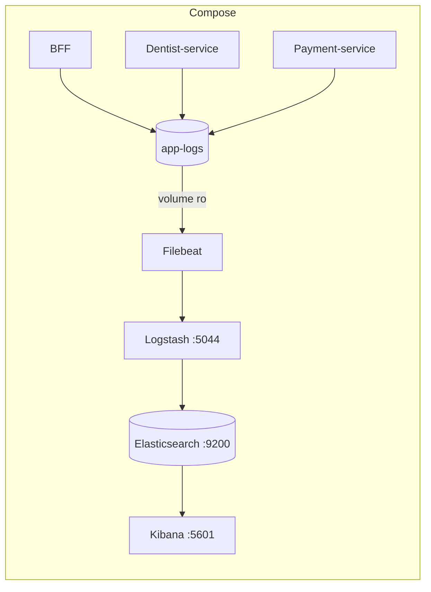

# ELK — logs da Odontologia Integrada

Stack **Elasticsearch + Logstash + Kibana + Filebeat** (8.17.4) para centralizar os logs
estruturados das aplicações. A stack e as aplicações são definidas no `compose.yaml` da raiz;
os serviços gravam arquivos JSON em um volume compartilhado com o Filebeat.



Escopo atual: **somente logs** (sem APM/métricas). Padrão dos campos e catálogo de eventos
em [`docs/logging-standard.md`](docs/logging-standard.md).

## Subir

Pré-requisito: Docker com memória suficiente para Elasticsearch, Logstash e Kibana. Os heaps
iniciais estão reduzidos para desenvolvimento; ajuste `ES_JAVA_OPTS` e `LS_JAVA_OPTS` no
`.env` da raiz se necessário.

```bash
docker compose --profile elk up -d
```

Ordem automática: `elasticsearch` → `es-setup` (política ILM e index template) →
`logstash` → `filebeat`; e `kibana` → `kibana-setup` (data view, buscas e dashboard).
A primeira subida leva alguns minutos. Acompanhe com `docker compose --profile elk ps`.

| Serviço | URL | Observação |
|---|---|---|
| Kibana | http://localhost:5601 | Dashboard **Odonto \| Visão geral de logs** |
| Elasticsearch | http://localhost:9200 | Segurança desativada (dev) |
| Logstash | `logstash:5044` | Apenas na rede interna do compose |

## Onde os serviços gravam

| Serviço | Configuração | Arquivo |
|---|---|---|
| Dentist-service | `Observability__LogDirectory=/app/logs` no Compose | `dentist-service/*.json` |
| Payment-service | `Observability__LogDirectory=/app/logs` no Compose | `payment-service/*.json` |
| BFF | `LOG_DIR=/app/logs` no Compose | `bff/bff.log` |

O volume `app-logs` é persistente e compartilhado entre aplicações e Filebeat. Para subir também
Prometheus e Grafana, use `docker compose --profile observability --profile elk up --build -d`.

## Consultas no Kibana

Em **Discover**, use a data view `odonto-logs` (`logs-*-dev`) ou as buscas salvas
`Odonto | ...`.

| Objetivo | KQL |
|---|---|
| Jornada de uma requisição | `labels.correlation_id : "teste-123"` |
| Agendamentos | `event.action : appointment.*` |
| Mensagens na DLQ | `event.action : consumer.dead_lettered` |
| Falhas do BFF em downstream | `event.action : downstream.*` |
| Erros | `log.level : error` |

Teste rápido de ponta a ponta: envie uma requisição a qualquer endpoint `/api/...` do BFF
com o header `X-Correlation-Id: teste-123` e busque `labels.correlation_id : "teste-123"`.
O `/health` não é indexado.

## Estrutura

| Arquivo | Função |
|---|---|
| `../compose.yaml` | Define ELK, aplicações, perfis e volumes compartilhados. |
| `filebeat/filebeat.yml` | Três inputs (bff, dentist-service, payment-service), parser NDJSON. |
| `logstash/pipeline/odonto.conf` | Normaliza `service.name`/`labels.correlation_id`, mascara PII, roteia para `logs-<servico>-dev`. |
| `elasticsearch/` | Política ILM (7 dias), index template e `setup.sh`. |
| `kibana/` | `setup.sh` + `saved-objects.ndjson` (data view, buscas e dashboard). |

## Solução de problemas

- **Elasticsearch reinicia no Linux/WSL2:** `sudo sysctl -w vm.max_map_count=262144`
  (no WSL2: `wsl -d docker-desktop sysctl -w vm.max_map_count=262144`).
- **Não aparece nada no Kibana:** confirme que as aplicações estão saudáveis,
  veja `docker compose --profile elk logs filebeat logstash` e o horário do filtro do Discover
  (padrão: últimas 24 h). O Filebeat varre a pasta a cada 5 s (bind mount no Windows não
  gera eventos de inotify).
- **Zerar dados:** `docker compose --profile observability --profile elk down -v` remove todos os volumes, incluindo bancos e Kafka.
- **Final de linha:** os `.sh` precisam ter final de linha LF (garantido por `.gitattributes`).
- **Memória insuficiente:** reduza `ES_JAVA_OPTS` e `LS_JAVA_OPTS` no `.env` da raiz.

## Produção

Esta configuração é para **desenvolvimento**: segurança do Elasticsearch/Kibana desativada,
sem TLS, nó único e sem réplicas. Em produção: habilitar `xpack.security` com TLS e
usuários/roles, mover a ingestão para agentes por host (ou Filebeat nos nós), revisar
retenção/ILM e backups (snapshots), restringir portas e mascarar dados pessoais na origem.
